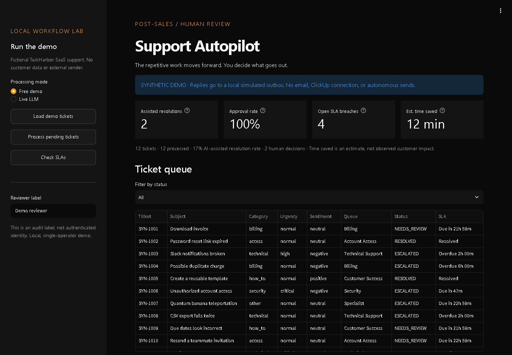
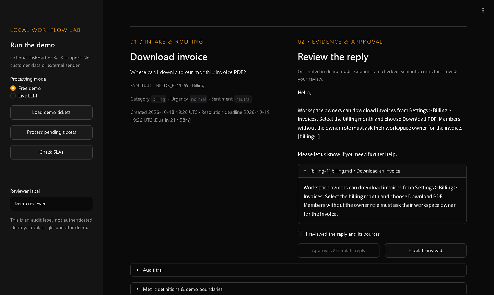
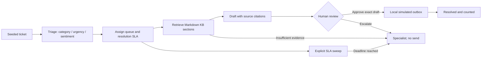

# AI Post-Sales Support Autopilot

[](https://github.com/dionnblake/ai-post-sales-support-autopilot/actions/workflows/tests.yml)

An LLM-assisted support pipeline that does the repetitive part of a support queue and leaves the send decision to a person.

Tickets come in. Each one gets triaged (category, urgency, sentiment), routed to the right queue, and given a resolution SLA. The pipeline pulls the relevant sections from a Markdown knowledge base, drafts a reply that cites them, and holds it for review. A reviewer reads the draft next to its sources and either approves it or escalates it. Anything that ages past its SLA gets escalated automatically.





> Portfolio project. It runs on localhost with synthetic tickets, and replies go to a simulated outbox. Nothing is sent to a real customer.

## What's worth looking at

- **Human approval is enforced in the data layer, not just the UI.** An approval is bound to a hash of the exact draft and the knowledge-base snapshot it was built from. Stale, duplicate, or concurrent approvals are rejected, and the approval plus outbox write happen in one SQLite transaction with a unique constraint. Two simultaneous clicks produce one send (there's a test for that).
- **Grounded drafting with citation checks.** Every draft has to cite retrieved KB sections by ID. Unknown or missing citations fail closed. No relevant evidence means escalation, not a made-up answer.
- **Safe failure everywhere.** Security reports and prompt-injection attempts route straight to the Security queue without a draft. Malformed model output, timeouts, and bad JSON land as an ERROR the reviewer can inspect, never as a silent retry or a paid fallback.
- **SLA handling that keeps context.** Resolution deadlines come from triaged urgency (critical 1h, high 4h, normal 24h, low 48h). The SLA sweep escalates breached tickets and keeps their original skill queue so the specialist knows where it came from.
- **Metrics that don't inflate.** Every number on the dashboard is computed from stored records, and the formulas are on screen. Because a human approves every reply, it reports *AI-assisted resolutions* instead of claiming deflection.
- **A real LLM path, opt-in.** Free demo mode uses transparent rules and extractive drafts, so it runs with no API key. Live mode calls any OpenAI-compatible chat-completions endpoint with structured JSON output, using only the standard library.
- **42 tests**, covering SQLite transactions, approval races, SLA boundaries, provider contract failures, the hosted first-load path, and a full Streamlit click-through.

## See the workflow



The demo includes invoice questions, expired password links, failed integrations, an outage, unsupported requests, a security report, and a prompt-injection attempt. The ticket and knowledge content is original and fictional; TaskHarbor is a fictional SaaS product.

## Run locally

Python 3.11+; developed on Windows with Python 3.13. A fresh environment is recommended.

```powershell
python -m venv .venv
.\.venv\Scripts\python.exe -m pip install -r requirements-dev.txt
.\run.ps1
```

On macOS/Linux:

```sh
python3 -m venv .venv
.venv/bin/python -m pip install -r requirements-dev.txt
.venv/bin/python -m streamlit run app.py --server.address 127.0.0.1 --server.port 8517
```

Open `http://127.0.0.1:8517`. Demo mode needs no API key, model download, cloud database, or external runtime service. Streamlit usage statistics are disabled for local runs.

### A two-minute walkthrough

1. Click **Load demo tickets**. Repeated clicks preserve existing tickets and reviews.
2. Click **Process pending tickets**. Check the categories, queues, and SLA breaches.
3. Open **SYN-1001 / Download invoice**. Compare the draft with its cited billing excerpt.
4. Check **I reviewed the reply and its sources**, then **Approve & simulate reply**.
5. The resolution count becomes one, estimated savings become six minutes, and the audit trail records approval and a local simulated send.
6. Inspect the unsupported request and security cases: they have no approvable reply. Inspect the older tickets: the SLA sweep escalates them without sending anything.

All generated runtime data stays in the project's ignored `data/` folder. Tests use unique project-local databases under `work/test-runs/`; they do not reset the demo database. To run a second independent demo, set `SUPPORT_DATA_DIR` to another directory **inside this project**.

### Hosted demo entrypoint

`streamlit_app.py` is the entrypoint for Streamlit Community Cloud. It runs the same dashboard, but when the database is empty it loads and processes the demo tickets, so a visitor lands on a populated queue. It never approves anything: every reply still waits for a reviewer to confirm and approve it. The hosted copy is shared by all visitors and keeps its SQLite file on the host's temporary disk, so the data can be wiped when Community Cloud restarts or redeploys the app. Live LLM mode stays off there: no provider settings are configured, so it cannot call a model. Community Cloud enforces its own usage-statistics setting.

## What is real, and what is simulated

| Part | Implementation |
|---|---|
| Intake | Original deterministic seed data; no live ticket integration |
| Demo triage | Transparent keyword rules; no claim that this mode uses a model |
| Live triage/drafting | Optional JSON chat-completions API adapter; explicit enablement and key |
| RAG | Actual local lexical retrieval over Markdown sections; no vector DB or embeddings |
| Demo drafting | Extractive reply from a retrieved section, with a checked source ID |
| Human review | Explicit approval bound to the exact draft and KB snapshot |
| Delivery | SQLite simulated outbox; no email or ClickUp sender exists |
| SLA | Elapsed UTC resolution deadlines; button/CLI sweep, not a background scheduler |
| Metrics | Calculated from persisted records; all examples are synthetic |

The demo cannot establish live model answer quality, actual customer outcomes, or production readiness. Citation validation proves that the referenced excerpt was retrieved; **it does not prove semantic correctness**. That remains part of human review.

## Optional live LLM mode

The standard-library adapter supports a trusted HTTPS endpoint implementing JSON chat completions. No SDK or agent framework is required. Set the following in the process that starts Streamlit; these values are not read from a committed file:

```powershell
$env:SUPPORT_ENABLE_LIVE_LLM = "1"
$env:SUPPORT_LLM_API_KEY = "<your-provider-key>"
$env:SUPPORT_LLM_MODEL = "<a-model-supporting-JSON-chat-completions>"
# Optional; this is the default endpoint:
$env:SUPPORT_LLM_BASE_URL = "https://api.openai.com/v1"
.\run.ps1
```

Choose **Live LLM**, explicitly allow the request, then process a selected unprocessed ticket. The configured model must support `response_format: json_object` and `max_tokens`. The adapter makes at most two requests for a ticket, has a 20-second timeout per request, limits response size, and refuses redirects. A failed or invalid response leaves an ERROR outcome for inspection, never an automatic paid retry or a silent switch to demo mode. Already processed demo drafts remain labeled demo; use a separate local data directory to try the same seeds with a real provider.

Provider charges may apply. Live mode transmits ticket content and retrieved excerpts to the configured endpoint. Use only the fictional demo content and a provider you trust. No live model calls were needed for the ordinary test suite.

## Metrics, without inflated claims

- **AI-assisted resolutions:** unique tickets with a human approval and local simulated outbox record.
- **AI-assisted resolution rate:** those resolutions divided by tickets that completed a processing attempt, including safe failure outcomes.
- **Human approval rate:** approved / (approved + reviewer-escalated). Automatic security/evidence/SLA escalation is excluded from the denominator. Zero reviews displays 0% with a zero review count, not observed performance.
- **Open SLA breaches:** unresolved tickets at or after their resolution deadline. Critical: 1 hour; high: 4; normal: 24; low: 48. Unprocessed tickets default to 24 hours. Existing skill queues are retained when aging is flagged.
- **Estimated time saved:** simulated resolutions × (8 assumed manual minutes − 2 assumed review minutes). This is illustrative, not measured savings.

Every reply requires human review, so this project does not claim autonomous resolutions or ticket deflection.

## Failure handling

- No relevant KB section: escalate without a fabricated reply.
- Security reports and recognized instruction-injection patterns: route to Security without drafting. The pattern check is illustrative, not comprehensive prompt-injection protection.
- Invalid classification, incomplete JSON, or unknown citations: safe ERROR, no send.
- Duplicate intake ID: return the existing ticket only when its original content and timestamp match; reject conflicting reuse.
- Duplicate or stale approval: reject. SQLite serializes the approval and uniquely constrains the outbox ticket ID.
- KB changed since drafting: reject approval until the content is reviewed and a fresh workflow is explicitly prepared; v1 has no in-place redraft UI.
- Rejected reply: invalidate its approval path and escalate; do not send.
- Database version mismatch: stop; no automatic migration of an existing database.

The reviewer label is not authentication. This is a single-operator demo (the hosted copy is one shared sandbox), not a tenant-isolated production service. The processing transaction can hold the local database lock during bounded API calls; a production worker queue would separate that boundary.

## Test and inspect

```powershell
.\.venv\Scripts\python.exe -m pytest -q
.\.venv\Scripts\python.exe -m support_autopilot seed
.\.venv\Scripts\python.exe -m support_autopilot process
.\.venv\Scripts\python.exe -m support_autopilot metrics
```

Tests exercise actual SQLite transactions, approval replay/concurrency, unknown evidence, SLA boundaries, structured provider contracts with a fake transport, and Streamlit's seed/process/review interaction. No tests call a paid provider. See [EVIDENCE.md](EVIDENCE.md) for verification scope.

## Next step: ClickUp webhooks

This is integration design only; no ClickUp connection is implemented.

1. Receive the selected workspace's relevant task events at a small HTTPS endpoint. Verify authenticity using ClickUp's current webhook security contract and keep secrets in server configuration.
2. Deduplicate deliveries using the provider's event identity and persist a receipt before processing. Fetch only the task fields needed to create a ticket; do not trust an event payload as authorization.
3. Map task ID, title, description, queue/status fields, priority, and timestamps into the existing intake contract. Keep webhook intake separate from model calls so the endpoint can acknowledge quickly.
4. Run the pipeline as a bounded background job, with retry limits, monitoring, and a real support calendar for SLAs.
5. Keep human approval bound to the exact draft. Only an approved outbox worker could write a comment or status update through ClickUp's API, with appropriate scopes and duplicate-delivery protection.
6. Add authenticated reviewer identities, webhook contract tests, secret management, retention rules, and a sandbox end-to-end run before any real workspace is connected.

## Project layout

```text
app.py                    Streamlit review dashboard
streamlit_app.py          Hosted-demo entrypoint (seeds an empty queue)
support_autopilot/        Retrieval, providers, workflow, seed data, CLI
kb/                       Original fictional support policies
tests/                    Workflow, API-contract, and UI tests
run.ps1                   Windows local launcher
data/                     Ignored demo SQLite database
work/                     Ignored local test/temp material
docs/                     README screenshots
```

I scoped the workflow and its approval boundary, chose the failure cases and metrics, and directed AI-assisted implementation and verification. This repository is a bounded demonstration of that work, not evidence of a deployed customer support service.
